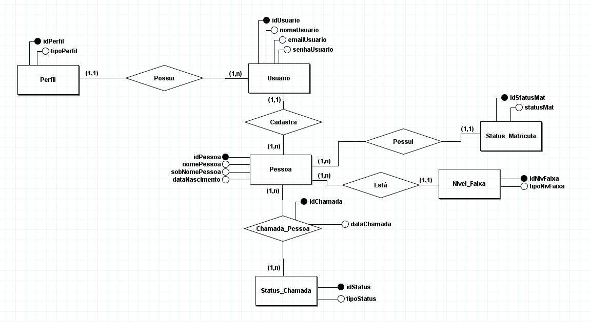
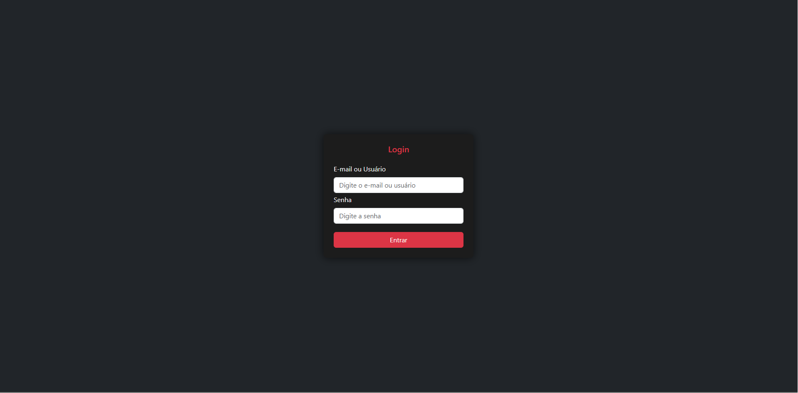
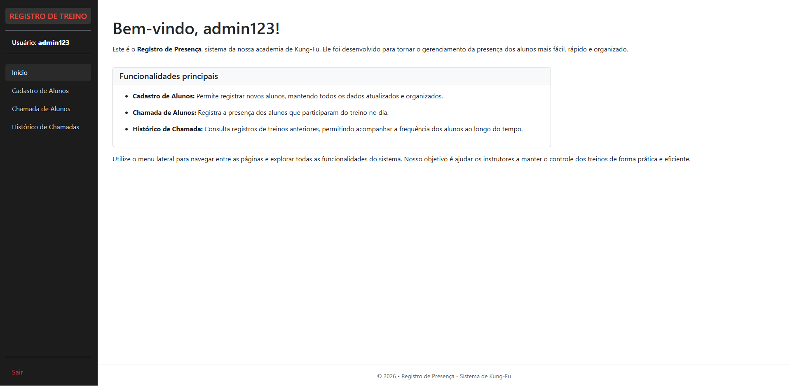
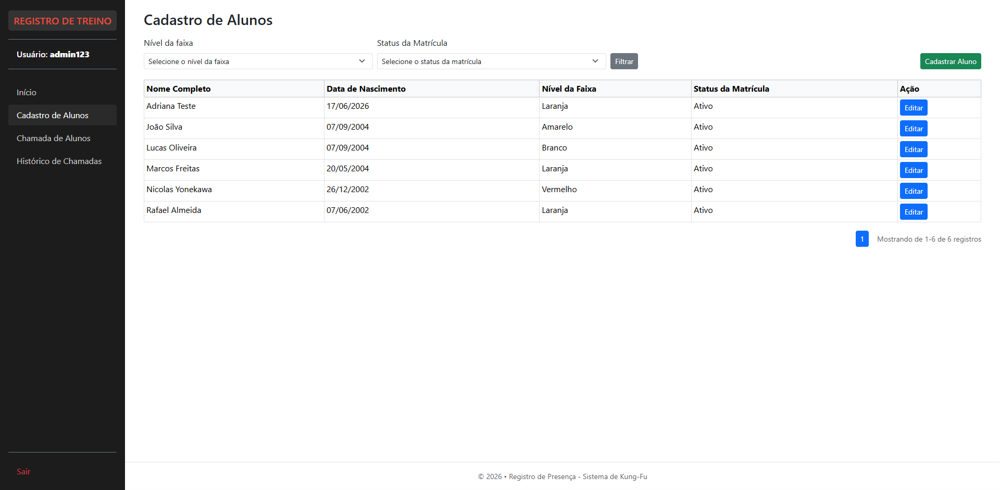
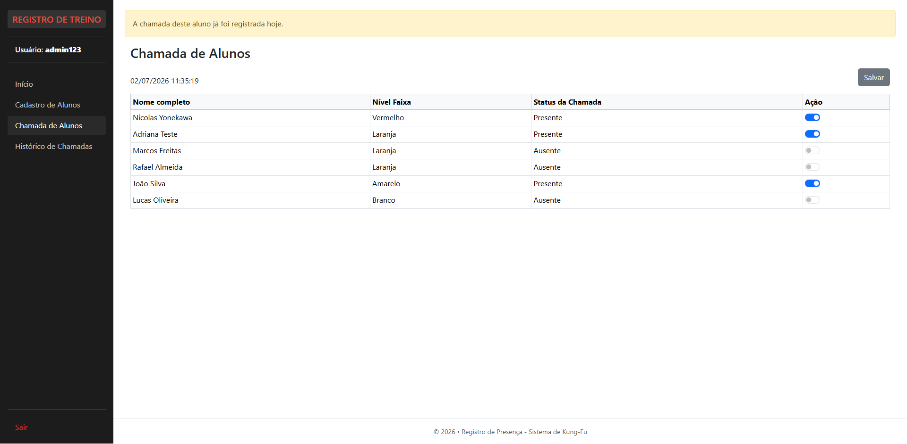
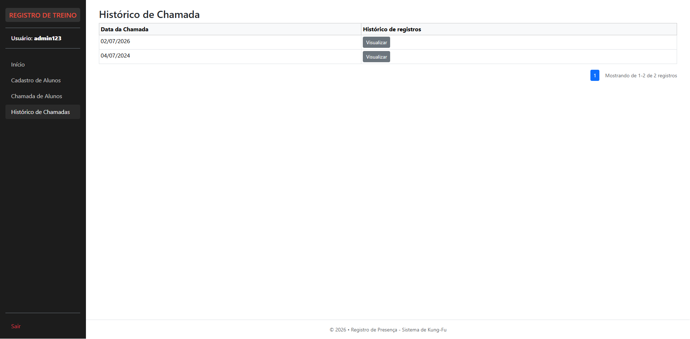

# Chamada Kung-Fu

<p>
Este sistema é uma aplicação web desenvolvida em PHP para controle de presença dos alunos em uma academia de Kung-Fu. O projeto foi criado com fins de estudo, aplicando uma arquitetura organizada baseada em MVC, com separação em Services, DTOs e Helpers.
</p>

## Sumário
* [Tecnologias utilizadas](#tecnologias-utilizadas)
* [Arquitetura do sistema](#arquitetura-do-sistema)
* [Organização geral](#organização-geral)
* [Detalhes da Arquitetura e Estrutura de Pastas](#detalhes-da-arquitetura-e-estrutura-de-pastas)
* [Modelagem do banco de dados](#modelagem-do-banco-de-dados)
* [Funcionalidades](#funcionalidades)
* [Telas do sistema](#telas-do-sistema)
* [Pré-requisitos de instalação](#pré-requistos-de-instalação)
* [Preparando o ambiente](#preparando-o-ambiente)
* [Objetivo](#objetivo)

## Tecnologias utilizadas
<ul>
  <li>PHP 8.2</li>
  <li>MySQL</li>
  <li>HTML5</li>
  <li>CSS3</li>
  <li>JavaScript</li>
  <li>Bootstrap</li>
  <li>Dev Container</li>
  <li>Docker</li>
</ul>

## Arquitetura do sistema

O projeto segue a arquitetura:
<ul>
  <li>MVC (Model-View-Controller)</li>
  <li>Services para regras de negócio</li>
  <li>DTO (Data Transfer Objects) para transporte de dados</li>
  <li>Helpers para funções auxiliares</li>
  <li>Exceptions para tratamento de erros</li>
</ul>

## Organização geral
<ul>
  <li>Models → Acesso ao banco de dados</li>
  <li>Views → Interface do usuário</li>
  <li>Controllers → Controle das requisições</li>
  <li>Services → Regras de negócio (ex: registrar presença)</li>
  <li>DTOs → Estruturas de dados entre camadas</li>
  <li>Helpers → Funções reutilizáveis (formatação, validação etc.)</li>
  <li>Exceptions → Tratamento de erros e validações do sistema</li>
</ul>

## Detalhes da Arquitetura e Estrutura de Pastas
```text
app
├── Controller
│   ├── CadastroAlunoController.php
│   ├── ChamadaAlunoController.php
│   └── LoginController.php
├── Dto
│   ├── CadastroAluno
│   │   ├── CadastroAlunoCampoAtualizacaoDto.php
│   │   ├── CadastroAlunoCampoDto.php
│   │   ├── CadastroAlunoDto.php
│   │   ├── CadastroAlunoEntradaDto.php
│   │   └── CadastroAlunoFiltroDto.php
│   ├── ChamadaAluno
│   │   ├── ChamadaAlunoDto.php
│   │   ├── ChamadaAlunoInsereDto.php
│   │   └── ChamadaAlunoSalvaDto.php
│   ├── HistoricoChamadaAluno
│   │   ├── HistoricoChamadaAlunoDto.php
│   │   ├── HistoricoChamadaAlunoEntradaDto.php
│   │   └── HistoricoChamadaAlunoPorDataDto.php
│   ├── Login
│   │   ├── LoginCampoDto.php
│   │   └── LoginDto.php
│   ├── NivelFaixaDto.php
│   ├── PaginacaoDto.php
│   ├── PerfilUsuarioDto.php
│   ├── StatusChamadaDto.php
│   └── StatusMatriculaDto.php
├── Exceptions
│   ├── CadastroAluno
│   │   ├── CadastroInvalidoException.php
│   │   └── FalhaCadastroException.php
│   └── ChamadaAluno
│       ├── ChamadaInvalidaException.php
│       └── FalhaChamadaException.php
├── Helpers
│   ├── CaminhoHelpers.php
│   ├── FormularioHelpers.php
│   ├── Logger.php
│   ├── MensagemHelpers.php
│   ├── PaginacaoHelpers.php
│   └── ValidacaoHelpers.php
├── Model
│   ├── CadastroAlunoModel.php
│   ├── ChamadaAlunoModel.php
│   ├── ClasseAuxiliarModel.php
│   └── LoginModel.php
├── Services
│   ├── CadastroAlunoService.php
│   ├── ChamadaAlunoService.php
│   ├── LoginService.php
│   └── SessaoService.php
└── view
    ├── cadastro_aluno
    │   ├── conteudo.php
    │   ├── index.php
    │   └── logica.php
    ├── chamada_aluno
    │   ├── conteudo.php
    │   ├── index.php
    │   └── logica.php
    ├── historico_chamada
    │   ├── conteudo.php
    │   ├── index.php
    │   └── logica.php
    ├── login
    │   ├── conteudo.php
    │   ├── index.php
    │   └── logica.php
    └── pagina_principal
        ├── conteudo.php
        ├── index.php
        └── logica.php
config
└── Conexao.php
database
├── 1-create_tables.sql
├── 2-insert_perfil.sql
├── 3-insert_usuario.sql
├── 4-insert_nivel_faixa.sql
├── 5-insert_status_matricula.sql
├── 6-insert_pessoa.sql
├── 7-insert_status_chamada.sql
└── 8-insert_chamada_pessoa.sql
public
├── assets
│   ├── script
│   │   └── modalCadastroAluno.js
│   └── style
│       └── style.css
├── components
│   ├── campo.php
│   ├── mensagem.php
│   ├── menu.php
│   ├── modal.php
│   ├── paginacao.php
│   ├── rodape.php
│   └── tabela.php
├── index.php
└── logout.php
```

## Modelagem do banco de dados
#### Modelo Entidade-Relacionamento


#### Modelo Lógico


## Funcionalidades
<ul>
  <li>Login de usuários</li>
  <li>Cadastro de alunos</li>
  <li>Registro de presença (chamada)</li>
  <li>Histórico de chamadas</li>
</ul>

<p>
  <b>Nota:</b> No registro de presença, os nomes dos alunos aparecem de forma automática, respeitando os dias programados de treino (terças-feiras e quintas-feiras), configurados desta forma para fins de teste.
</p>

## Telas do sistema

#### Tela de login


#### Tela inicial


#### Tela de cadastro de alunos


#### Tela de chamada de alunos (registro de presença)


#### Tela de histórico de chamada



## Pré-requistos de instalação
Para instalar o projeto, é necessário ter as seguintes ferramentas:
<ul>
  <li>Docker</li>
  <li>WSL ou Linux (para rodar o Docker)</li>
  <li>VS Code (Recomendado para facilitar o desenvolvimento)</li>
</ul>

## Preparando o ambiente:

#### Passo 1
Dentro do VS Code, abra o projeto e crie um arquivo `.env` na raiz, inserindo as seguintes variáveis de ambiente:
```text
BANCO_ENDERECO="db"
BANCO_USUARIO="root"
BANCO_SENHA="12345"
BANCO_NOME="kung_fu"
BANCO_PORTA="3306"

CONTAINER_BANCO_SENHA=12345
CONTAINER_BANCO_NOME=kung_fu
```

#### Passo 2
No menu lateral esquerdo, na aba **Extensions**, procure por `Dev Containers` ou `ms-vscode-remote.remote-containers` e clique em **Install**.


#### Passo 3 (apenas WSL)
Caso utilize o WSL, é necessário habilitar uma configuração para executar o Dev Container dentro da máquina virtual Linux. No VS Code, acesse **Manage (ícone de engrenagem) > Settings**, digite `Execute in WSL` na caixa de pesquisa e selecione a opção conforme a imagem abaixo:


#### Passo 4
Após instalar a extensão do Dev Container, uma notificação aparecerá para abrir o projeto dentro do ambiente isolado. Basta clicar em **Reopen in Container** e aguardar a inicialização dos containers da aplicação e do banco de dados.


Caso a notificação não apareça, pressione as teclas **`Ctrl + Shift + P`** e selecione a opção **Dev Containers: Reopen in Container**.


#### Passo 5
Com o ambiente dos containers pronto, é necessário baixar as dependências do projeto antes de iniciar a aplicação. No menu superior do VS Code, abra o **Terminal**, certifique-se de que está usando o **Bash** e digite o seguinte comando:
```bash
composer install
```

#### Passo 6
Ainda no terminal **Bash**, execute o comando abaixo para gerar o mapeamento atualizado das classes do projeto:
```bash
composer dump-autoload
```

#### Passo 7
Com o projeto devidamente configurado, execute o script de automação para inicializar o ecossistema:
```bash
./start.sh
```

#### Passo 8
Para acessar a aplicação, utilize o seguinte endereço no seu navegador, que o redirecionará para a página de login:
```text
http://localhost:8001/public
```
#### Passo 9
Por último, para acessar o login, insira as seguintes credenciais para teste:
<ul>
  <li><b>E-mail:</b> admin_kung@gmail.com</li>
  <li><b>Usuário:</b> admin123</li>
  <li><b>Senha:</b> Admin@123</li>
</ul>

<p>
  <b>Nota:</b> Caso queira utilizar outra conta, basta acessar a tabela <code>usuario</code> do banco de dados.
</p>

## Objetivo
Este projeto foi desenvolvido para prática de arquitetura em PHP, com foco em organização de código, separação de responsabilidades e boas práticas de desenvolvimento web.
